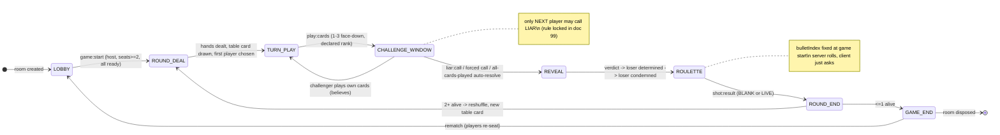

# 06 — Multiplayer Networking Architecture (the engineering bible)

> Deep-dive for: free-to-play, browser-based Liar's Deck clone ("Liar's Bar" web version),
> 2–7 players/room, mobile + desktop, no voice/text AI, Node.js server.
> Written 2026-11-23. Sources cited inline; full list at bottom.
> Companion docs: 05 (rules engine), 07 (client), 11 (deployment). This doc = the networking contract.

---

## 1. Transport decision

Options evaluated for real-time game traffic:

| Criterion | **Socket.IO (WebSocket + fallback)** | **Raw WebSocket (`ws`)** | **SSE (EventSource)** | **HTTP long-polling** |
|---|---|---|---|---|
| Direction | Bidirectional | Bidirectional | **Server→client only** | Bidirectional-but-awkward |
| Typical latency | ~1 RTT once connected; a few bytes of protocol overhead per packet (`42["event",…]`) ([Socket.IO docs: Introduction](https://socket.io/docs/v4/)) | Lowest; 2-byte frame headers | Low for server pushes; client actions need **separate** HTTP requests | Worst; each update waits for next poll cycle + full HTTP header overhead |
| Reconnect handling | Built-in: heartbeat + exponential-backoff auto-reconnect + packet buffering while offline ([docs](https://socket.io/docs/v4/)) | None — you build it | Built into EventSource with `Last-Event-ID` replay header | Roll your own |
| Missed-message recovery | Yes — connection state recovery resends packets missed during short drops ([docs](https://socket.io/docs/v4/connection-state-recovery)) | No | Yes (with Last-Event-ID + server buffer) | No |
| Mobile Safari quirks | Same WS quirks underneath, **but reconnect/fallback handled for you** (see below) | Same quirks, all handling on you | Handles device lock/sleep well; but 6-connection-per-origin limit per browser on HTTP/1.1, proxy buffering can silently delay events | Worst on flaky mobile |
| Proxy / CDN / corporate wifi | Auto-falls back to HTTP long-polling when WebSocket is blocked by a misconfigured proxy — Socket.IO's own docs call this still a real-world occurrence | Blocked = dead connection | Passes almost everywhere (plain HTTP) | Passes everywhere |
| Effort | Low — rooms, acks, timeouts, reconnect all included | High — you rebuild acks, rooms, heartbeat, reconnect, fallback | Medium — plus a second channel for client→server actions anyway | High, and worst UX |
| Verdict | **✅ Our choice** | Only for 100k+ conn hot paths we don't have | Wrong shape (one-way; we need play/liar/shot *upstream*) | Fallback only (we get it free inside Socket.IO) |

**Mobile Safari realities we must design around (not argue with):**

- iOS Safari **kills the WebSocket when the screen locks or the app is backgrounded**; reconnection after unlock frequently
  does not fire an `onclose`, leaving zombie sockets (WebKit bug 247943; graphql-ws discussion #290).
- iOS 26 Safari shipped a WebSocket-upgrade regression (late 2025) — upgrade requests failing intermittently ([jackpearce.co.uk](https://www.jackpearce.co.uk/posts/debugging-websocket-upgrade-failures-safari-ios26/)). Fallback + angry reconnects saved many sites.
- WebKit historically doesn't emit `close`/`error` when the network vanishes mid-session → **server-side heartbeat is mandatory**
  (Socket.IO's Engine.IO heartbeat: 25s ping interval + 20s timeout by default, i.e. dead sockets detected in ≤45s).
- Conclusion: never build a Liar's Deck on bare `ws` — we'd reimplement Socket.IO badly. (Socket.IO's own FAQ: "if you use plain
  WebSockets … you will eventually need to implement most of the features that are already included.")

**Proxy/CDN note (from Scalability of Use, docs):** if behind nginx, `proxy_read_timeout` must exceed `pingInterval + pingTimeout`
(60s default must be > 45s) or nginx closes idle-but-healthy sockets ("transport close" storms). Standard upgrade headers required
(`proxy_http_version 1.1; Upgrade/Connection`). Cloudflare supports WebSockets on all plans.

**Verdict:** **Socket.IO over WebSocket, with HTTP long-polling only as its automatic fallback.** Turn-based 2–7 player
poker-like play needs ≤ a handful of small messages per second — sub-millisecond raw-ws gains are irrelevant, while
auto-reconnect + fallback + rooms + acks are exactly the 4 things we need for mobile Safari roulette. SSE and long-polling
are eliminated as primary transports (SSE is one-way; long-polling is the worst latency/efficiency).

---

## Do I need WebSocket or an API key?

> Layman answer to the owner's question. Short version: **these are two unrelated things.**

- **An API key is a credential** — like the PIN to someone else's ATM. It's what *we* use to prove *our server's* identity
  when calling a **third-party service** (e.g., Stripe's API key when charging for the cosmetic bar theme; an email
  provider's key; an analytics key). API keys have **nothing to do with how players' browsers talk to our game server.**
- **WebSocket is a telephone line** — a persistent, open connection between a player's browser and *our* server so the
  server can push "Foxy played 2 cards" the instant it happens, instead of the browser asking "anything new?" 50 times a minute.
- **We need OUR OWN WebSocket server — and no third-party "game API" at all.** The game (shuffling, hands, liar calls,
  roulette) runs entirely in code we write. There is nothing to rent: no game-API vendor, no voice AI, no text AI
  (zero AI features by requirement — players bring their own voice on Discord/WhatsApp). So during the actual gameplay,
  **$0 of third-party API is involved.**
- **Where API keys *do* appear in our project:** payment provider (selling cosmetic themes), maybe analytics/email later.
  Those keys live **only on our server**, never in browser code. (Key-security details: doc 09 payments/security.)
- **Plain REST API still exists alongside** for non-realtime things: login/account, browsing the theme store, purchase
  confirmation, leaderboards. Those are classic request/response — browser asks once, server answers once, done.
  Real-time game traffic is the only thing that travels over WebSocket.

**Analogy for the whole architecture:** REST API = the bar's front desk (buying drinks, memberships, merch).
Socket.IO = the actual poker table conversation happening live in the back room. Both are run by the same bar (our Node.js server).

---

## 2. Server-authoritative design

**Rule #1: the server owns ALL state. Clients render it. Always.**

Why non-negotiable, specific to Liar's Deck:

| State | Why client must NEVER have it before time |
|---|---|
| Other players' hands | The entire game is bluffing about hidden cards. Any leak = game is dead on arrival |
| Deck order after shuffle | zero-knowledge of future draws prevents any client-side "peek" cheat |
| Table card | OK to send (it's public) — but only the server decides it |
| **Roulette bullet position** | Life-or-death. Only the server rolls. A client that "pulls its own trigger" would just send "blank, please" |
| Challenge arbitration | Who called liar first, on which play, and whether the accusation lands — must be one referee, not 7 opinions |

Implementation contract:

- The **full game state lives in a single `GameRoom` object per room** on the server (deck, hands, pile metadata, bullet
  positions, pull counts, phase, timers). Clients hold only a *rendered shadow* of what they're allowed to see.
- Clients **send intents, never facts**: `play:cards {cardIds:[…]}` means "I want to play these". Server validates:
  is it your turn, do you own those exact card IDs (known server-side!), 1–3 cards, correct phase. Invalid intent → `error` event, no state change.
- **Per-socket filtered emission ("need-to-know state")**: same event, different payloads per recipient. When a play happens,
  the player *sees* their played cards; everyone else receives only `{playerId, count, claimedRank}` — the card VALUES
  travel only inside `reveal:show`, sent once, at challenge resolution, to the whole room (then it's public info).
- Anti-pattern to avoid: a shared "world state" object diffed per client by some clever serializer. You *can't* "cleverly"
  filter hidden cards — a bug leaks the whole game. Instead: **server code composes each payload explicitly**, and hidden
  fields simply aren't in the object. For an even harder guarantee, put card values in a separate server-only structure
  (`revealedCards`), never in the serializable state at all.
- Cheating surface: even if a player inspects dev-tools WebSocket frames, they see only what was already broadcast to them.
  The only "hacks" left are social (card counting, which is legal/encouraged in the real game).

**Full snapshot vs delta events — recommendation: events-first, snapshot-as-backstop.**

1. **During play: event stream.** Each broadcast carries `seq` (monotonic per room). Clients apply events in order —
   this matches the game's own event nature (a play, a call, a reveal, a shot) and keeps animations natural.
2. **On (re)join or after gap: full filtered snapshot.** Joining, reconnecting (even via Socket.IO recovery) or a
   client-detected `seq` hole triggers `state:sync` → a per-player snapshot of everything visible to that seat:
   phase, seats, presence, hand counts, *your* hand, pile, pull counts, current deadlines, `seq`.
3. Cost sanity: a snapshot is < 1.5 KB for 7 players; re-snapshotting a whole room costs ~10 KB amortized — irrelevant.
   The *developer* simplicity of "client can always ask for a fresh brain" is worth more than the bytes.
4. Why not snapshot-only: pure snapshot broadcasting forces the client to infer "what changed" for animations
   (what got played, whose turn ended) — you end up re-inventing events badly. Events + idempotent snapshots is the
   boring, robust hybrid every turn-based card game ships.

---

## 3. Room system design

### 3.1 Room codes: length, charset, entropy, collisions

- **Charset: 25 unambiguous uppercase characters** (A–Z minus I, O + digits 2–9 minus... just: `ABCDEFGHJKMNPQRSTUVWXYZ23456789`
  minus L? — pick the standard confusable-stripped 25-set, like Jackbox uses: no I, L, O, 0, 1). Typed on phones, read aloud on streams.
- **Length: 4 characters.** Entropy math:
  - Code space = 25⁴ = **390,625 codes ≈ 18.6 bits.**
  - Collision with N *active* rooms (birthday bound, random draw): P ≈ 1 − e^(−N²/2·390625). At 1,000 concurrent rooms → 0.26%; at 5,000 → ~99.9% at least one exists, but **that's fine — see next line.**
  - **Server resolves collisions by regeneration**: keep active codes in a `Set`, loop `do { code = gen() } while (active.has(code))`.
    Expected loop iterations at 1,000 active rooms = 1/(1−0.0026) ≈ 1.003. Collision handling is thus free; only exotic-entropy paranoia buys 5-char codes.
  - **Brute-force guessing** is the real cost driver: with A active rooms, one random join attempt hits live rooms w.p. A·N / 390,625 (N = guesses). 100 rooms + 1,000 guesses ≈ 26% *someone's* room gets ratted. → **Rate-limit `room:join` failures:** ≤ 10 wrong codes/min per IP, escalating backoff + captcha after repeated misses (auth doc 09). A 4-char code behind a rate limiter is stronger than an 8-char code without one.
- **Verdict: 4 chars, 25-char set, server collision regeneration, join rate limiting.** Upgrade to 5 chars if we exceed
  ~2,000 concurrent active rooms or see griefing (that's a config constant, not a redesign).

### 3.2 Lobby, seats, ready states

- Room states: `public (in lobby list)` or `code-only` (default; friends share the code). Seat count: **2–7**.
- Each seat: `{ playerId, name, avatar, connected, ready, isHost, alive }`. Empty seats visible as ghost chairs.
- Ready flow: seated players toggle `ready`; **host** picks bar theme and presses start. Server enforces ≥2 seats to start.
- Host = **oldest-seated connected player** (first-join precedence). Host migration: on host disconnect/leave →
  auto-assign to longest-connected remaining seat, broadcast `lobby:update`. Host powers are lobby-only (theme, start,
  kick) — host leaving mid-game changes nothing gameplay-wise.
- Idle room: auto-dispose when 0 connected sockets for 5 min (lobby) / immediately at `game:over` if nobody re-seats.

### 3.3 Mid-game reconnect (the make-or-break UX for a bluffing game)

- **Player token:** at join, server issues a random 128-bit `reconnectToken` bound to `playerId + roomId`, survives page
  reload (client stores in `sessionStorage`). Socket.IO's own connection-state-recovery covers *short* drops (config:
  `maxDisconnectionDuration` — see docs), but our token layer covers the *long* cases (reload, app switch, safari kill) —
  Colyseus models the same split (automatic vs manual reconnection) and we mirror the proven pattern.
- **Grace window: 90 seconds** (inside the 60–120s range owner approved). During grace: seat is **held**, NOT freed;
  `presence:state {connected:false}` is broadcast ("reconnecting…" avatar); round keeps running per 3.4 rules.
- Past grace ⇒ forfeiture: seat converted to spectator seat, cards auto-resolved by the rules engine, presence shows "left".
- **Which phase does a reconnecter rejoin?** *Exactly the phase the room is in* — they get full-phase data on the snapshot
  (e.g., mid-REVEAL: revealed cards + verdict; mid-ROULETTE: who is condemned, pull count; if it's their turn: their
  hand back + remaining deadline). No replay of past animations; the client renders current state plainly. Simple, correct, no timeline bookkeeping.

### 3.4 Disconnect/AFK handling per phase (seats stay held; the game keeps moving)

| Phase | Who's missing | Server behavior |
|---|---|---|
| LOBBY | anyone | nothing; seat can be taken over by same token only |
| TURN_PLAY (their turn) | current player | Pause drama: show "waiting…" up to **10s cushion** past their 30s turn timer while grace token runs; then **auto-play: play exactly 1 face-down card** (least-information default; never auto-call-liar which could kill them wrongly). Applied same whether AFK or disconnected. |
| TURN_PLAY (others) | observer to the drama | None — their turn timers unaffected |
| CHALLENGE_WINDOW (they're the eligible challenger) | the only person who can call | Their timer expiry = **auto-believe** (they proceed as normal turn player → then auto-play per row above) |
| REVEAL | anyone | None — reveal is instant server arbitration |
| ROULETTE (condemned) | the one holding the gun | **Hold ≤10s for the dramatic click**, then **server auto-pull**: `shot:pull` is a request, never a command — the outcome was decided server-side at pull time from `bulletIndex` which was seeded at game start. Result broadcast; game flows to ROUND_END. |
| ROUND_END | anyone | None |

- Underlying dead-socket detection: Engine.IO heartbeat (25s ping / 20s timeout) detects zombie Safari sockets in ≤45s;
  our 30s turn timers + 90s grace + auto-play rules mean detection lag never stalls a game more than the 10s cushion.
- **AFK vs disconnect are unified:** server only knows "no packets + no actions". Both get the auto-play/skip treatment
  above (a present-but-idle player gets the same consequence as a dropped one — no "AFK to avoid the shot" exploit).
- Repeated auto-plays: track `consecutiveAutoActions`; ≥3 in a game → lobby-wide "AFK player" notice; ≥5 → offer to room
  a kick-vote (post-game). Never silently eject a holding-reconnect player mid-round.

### 3.5 Min-player & elimination logic on leaves

- **Spectators:** eliminated (dead) players **stay in the socket room**, receive all events (everything is public after
  their death), flagged `alive:false`. They can chat-spectate and leave freely — leaving has zero gameplay effect.
- **Connected-active count** = players `alive AND (connected OR within grace)`.
  - Leaves **2+** → keep playing normally, no action needed.
  - Drops to **1** → instant `game:over { winnerId: "by default" }` — the winner is who remains, matching the game's last-alive logic.
  - Drops to **0** (everyone closes the tab) → `game:abort` → room auto-disposed.
- A player intentionally leaving mid-round (`room:leave`, consented, past grace) triggers rules-engine hook
  `onForfeit(playerId)`: their obligations resolve as the auto-rules above (pending pile-reveal if they were the accused,
  etc.). Networking contract: **every player removal must leave the FSM in exactly one deterministic next state.**

---

## 4. The game state machine (FSM)

One FSM instance per `GameRoom`, fully server-side. Clients get phase in every snapshot; clients never mutate it.



Transition triggers (inputs) → the server is the only thing allowed to pull them:

| Transition | Triggering input | Timing |
|---|---|---|
| LOBBY→ROUND_DEAL | `game:start` from host | — |
| ROUND_DEAL→TURN_PLAY | server (shuffle + deal complete) | ~1s deal animation window |
| TURN_PLAY→CHALLENGE_WINDOW | `play:cards` valid | 30s turn timer **cancelled** |
| CHALLENGE_WINDOW→TURN_PLAY | valid `play:cards` from eligible challenger | new 30s timer |
| CHALLENGE_WINDOW→REVEAL | `liar:call` from the one eligible challenger · forced call (>2 forced-call rules, headsup auto-der) | 30s window |
| REVEAL→ROULETTE | server, after broadcast pause (~3s cinematic) | — |
| ROULETTE→ROUND_END | `shot:pull` or AFK auto-pull | 10s drama window |
| ROUND_END→ROUND_DEAL or GAME_END | server | ~5s results window |
| ANY→LOBBY | players < 2 active | instant |

**The challenge race condition — and why a server kills it by existing.**

"What if two players call LIAR at the exact same moment?"

- **In our rule set only one player is ever eligible** (the next player after the play), so a true two-player tie cannot
  exist. But the *general* pattern still matters: `liar:call` racing `play:cards` from the same challenger, racing the
  turn-timer expiry auto-action, or (in a hypothetical any-player variant) two callers.
- **First event to reach the server wins. Full stop.** Node.js's event loop is single-threaded: each socket handler runs
  to completion; there is no interleaving inside a handler. Arrival order on the wire = decision order. The second event
  is validated against the *new* phase and gets `error { code: "E_NOT_CHALLENGE_WINDOW" }` — harmless no-op on state.
- **One rule for the team:** all state mutations (player inputs *and* timer fires) funnel through a single synchronous
  per-room `apply(action)` command handler. No `await` between validate-check-apply-broadcast. If a handler ever needs
  async I/O, the room takes a per-room queue — never interleaved mutation.
- Timer kill-switch: every scheduled timeout carries the `phaseToken` it was armed with; firing compares tokens and no-ops
  if the phase moved (prevents the ghost of TURN_PLAY's timer firing during REVEAL).
- Optional audit trail: append `(seq, action, actorId)` to an in-memory ring buffer per room → trivially replay every dispute and bug report as a hand history.

---

## 5. Event protocol spec (Socket.IO v4)

Namespace: default `/` (single game — no need for namespaces). Every server→client game payload: **`seq`** (room monotonic counter) + `serverNow` when a deadline matters. Client→server actions requiring a response use **Socket.IO acknowledgements** (with `socket.timeout(ms)`); broadcasts are fire-and-forget.

| Event | Direction | Payload fields | Notes / validation |
|---|---|---|---|
| `room:create` | C→S (ack) | `{ themeId?: string }` | → ack `{ code, roomId, you }` |
| `room:join` | C→S (ack) | `{ code, token?, playerName }` | rate-limited; token = rejoin case. → ack `{ code, snapshot }` or `error` |
| `room:leave` | C→S | `{}` | consented leave → forfeit hooks |
| `room:state` | S→C | full **filtered snapshot** (see Example 1) | on join/rejoin/resync |
| `lobby:update` | S→C | `{ seats[], hostId, theme }` | seats, ready flags, theme change |
| `lobby:ready` | C→S | `{ ready: boolean }` | seat-bound |
| `game:start` | C→S | `{}` | host only, ≥2 seated |
| `round:newTable` | S→C | `{ round, tableCard, yourHand[], handCounts{playerId:int}, firstPlayerId, deadline }` | **yourHand only to its socket**; others get counts |
| `turn:yourTurn` | S→C (targeted) | `{ currentPlayerId=you, deadline, forced?: bool }` | also used for challenge windows (`as: "challenge"`) |
| `turn:advance` | S→C | `{ currentPlayerId, deadline, phase }` | broadcast: whose clock runs |
| `play:cards` | C→S (ack) | `{ cardIds: string[] }` | 1–3 cards, owner+, phase=TURN_PLAY/CHALLENGE |
| `play:played` | S→C | `{ playerId, count, declaredRank, pileTotal }` | **no card values ever** (see Example 2) |
| `liar:call` | C→S (ack) | `{ targetPlaySeq }` | only eligible challenger; stale seq → error |
| `reveal:show` | S→C | `{ callerId, accusedId, cards[{id,rank,isJoker}], verdict, loserId, seq }` | the only event carrying hidden values (Example 3) |
| `shot:pull` | C→S | `{}` | *request* only; server may auto-pull on timeout |
| `shot:result` | S→C | `{ shooterId, pullNumber, result: "BLANK"\|"LIVE", alive, eliminated }` | bullet position itself stays secret until death reveal |
| `round:result` | S→C | `{ loserId, eliminated, aliveIds[], nextFirstPlayerId, deadline }` | bridge to next round |
| `game:over` | S→C | `{ winnerId, stats }` | last alive / by default |
| `game:abort` | S→C | `{ reason: "empty"\|"players_below_min" }` | |
| `presence:state` | S→C | `{ playerId, connected, inGrace, alive }` | drives reconnecting…/AFK badges |
| `state:sync` | C→S (ack) | `{ lastSeqReceived }` | client-detected gap → server replies `room:state` |
| `error` | S→C (ack or broadcast) | `{ code, message, seq? }` | never crashes; always recoverable |

Matching phrase "state:sync": the client keeps `lastSeq`; any hole or desync symptom → ask for snapshot. Idempotent.

**Example 1 — `room:join` ack (rejoining mid-game; filtered snapshot):**

```json
{
  "code": "HX7K",
  "snapshot": {
    "seq": 422,
    "serverNow": 1794971023500,
    "phase": "TURN_PLAY",
    "round": 3,
    "tableCard": "ACE",
    "you": { "playerId": "p_foxy", "seat": 2, "alive": true,
             "hand": ["c_17", "c_08", "c_11"], "pulls": 0, "connected": true },
    "players": [
      { "playerId": "p_foxy",   "name": "Foxy",  "seat": 2, "handCount": 3, "pulls": 0, "alive": true },
      { "playerId": "p_scubby", "name": "Scubby", "seat": 4, "handCount": 1, "pulls": 2, "alive": true },
      { "playerId": "p_toar",   "name": "Toar",  "seat": 6, "handCount": 0, "pulls": 5, "alive": true, "inGrace": true }
    ],
    "pile": { "playerId": "p_scubby", "count": 2, "claimedRank": "ACE" },
    "currentPlayerId": "p_foxy",
    "deadline": 1794971053500,
    "hostId": "p_foxy"
  }
}
```
Note: only `you.hand` has card IDs; Toar's offline-but-held seat flagged; reconnecter drops *straight into their turn* with 30s left.

**Example 2 — `play:cards` round-trip:**

```json
// client -> server (ack):      { "cardIds": ["c_17", "c_11"] }
// server ack to sender:        { "ok": true, "seq": 423 }
// broadcast play:played:
{
  "playerId": "p_foxy",
  "count": 2,
  "declaredRank": "ACE",
  "pileTotal": 4,
  "seq": 423
}
// then targeted at eligible challenger:
{ "event": "turn:yourTurn", "phase": "CHALLENGE_WINDOW",
  "deadline": 1794971084000, "forced": false, "seq": 424 }
```
No card values anywhere — values are server-only until a `reveal:show`.

**Example 3 — `reveal:show` (the payoff moment):**

```json
{
  "callerId": "p_scubby",
  "accusedId": "p_foxy",
  "targetPlaySeq": 423,
  "cards": [
    { "id": "c_17", "rank": "ACE",    "isJoker": false },
    { "id": "c_11", "rank": "QUEEN",  "isJoker": false }
  ],
  "verdict": "LIAR",
  "loserId": "p_foxy",
  "loserPullsAfterShot": 1,
  "seq": 425
}
```
Server judged: one non-table card → accused lied → Foxy to ROULETTE. Next: `shot:pull` request or auto after 10s → `shot:result`.

Micro-protocol notes:
- `seq` lets late/reordered deliveries self-check; duplicates/no-op reorderings can't corrupt: events are applied only if `seq > lastSeq`.
- Keep payloads flat & small (<.5KB each) — mobile data plans. A reveal is the biggest event in the game (~300B).
- All ids are opaque strings; never trust client-supplied `playerId` (use the socket's bound identity —
  assigned at `room:join`/auth middleware, socket.handshake or token).

---

## 6. Clocks & timers

- **All timers live on the server.** The client *displays* a countdown; it never *decides* anything.
- **Recommended pattern: deadline timestamps, not ticks.** Each phase change broadcasts `{ deadline: <server epoch ms>, serverNow }`.
  Client computes `serverOffset = serverNow - Date.now()` (refreshed per event, cheap median over last few events) and
  renders `deadline - (Date.now() + offset)`. ZERO per-second traffic; N players = 0 messages/sec for the clock vs 2–7 msgs/sec with a 1s tick.
- Server enforcement is its own `setTimeout(phaseDeadline - now)`, tagged with the **phaseToken** (see §4), which fires
  the auto-action (auto-play / auto-believe / auto-pull) exactly once.
- Never do "tick every second + broadcast remaining": for 5,000 rooms × 5 sockets = 25k msg/s of pure clock spam. One
  deadline number per phase change is both cheaper and more accurate (client device clocks skew; we never trust them for logic).
- Turn timer = **30s (locked, matches original)**; ROULETTE drama window = 10s; ROUND_END pad = 5s. All one config table.

---

## 7. Scaling reality check (numbers first, hardware later)

**Per-connection memory (published measured numbers):**

| Server | ~Per idle connection | 10k connections | 100k connections |
|---|---|---|---|
| Socket.IO (with default `ws`) | ~4–8 KB ([lh0x00.dev comparison](https://lh0x00.dev/p/socketio-vs-ws-vs-uwebsockets), [Dev benchmarks](https://dev.to/alex_aslam/nodejs-websockets-when-to-use-ws-vs-socketio-and-why-we-switched-di9)) | ~80–200 MB (official charts: 0→10k clients at [socket.io memory-usage docs](https://socket.io/docs/v4/memory-usage/)) | ~450 MB–2 GB * |
| raw `ws` | ~1.2–3 KB | ~30–100 MB | ~120 MB ([lh0x00.dev](https://lh0x00.dev/p/socketio-vs-ws-vs-uwebsockets)) |
| µWebSockets.js | ~0.9 KB | ~9 MB | ~90 MB |

*\*Spread across independent benchmarks; directionally consistent: Socket.IO costs a few KB per socket + Node heap baseline. Conservative budget: **plan 15,000–20,000 concurrent sockets per 1 GB RAM Node process** to leave headroom for buffers/GC.*

**Do the math for THIS game:**

- One room = 2–7 sockets (avg ~4.5) + one `GameRoom` object (a 20-card deck + 7 player records + FSM ≈ a few KB) ≈ trivial.
- Socket budget 15k/GB ÷ 4.5 sockets/room ≈ **3,300 concurrent full rooms ≈ 15,000 concurrent players on ONE ~1GB Node instance.**
- Message volume: a round emits ~30–60 events × ~300 bytes; mean live-room rate ≈ 1–2 msg/s. 3,300 rooms ≈ **≈6k msg/s —
  far below what Socket.IO + Node handle comfortably** (its own bench repo pushes 10k*clients* message storms).
- CPU is dominated by encryption + JSON, both linear and small. Turn-based = no game loop, no per-frame broadcasting. The
  event loop is idle >95% of the time.

**When do we add the Redis adapter + sticky sessions? Only when both are true:**

1. **> ~10–15k concurrent players** (a ~3–5k-room瓶颈 nearing one process's comfort zone), or we want multi-process *high availability*; AND
2. We run **multiple Node processes** behind one load balancer.

Then: the Socket.IO **Redis (Streams) adapter** forwards cross-process room broadcasts (docs: Using multiple nodes), and
the LB must enable **sticky sessions** *because we keep HTTP long-polling enabled as fallback* — sticky keeps a client's
polling requests on the originating node. (Alternative: `transports:["websocket"]` client-side drops polling fallback and
the sticky requirement — we keep sticky+fallback for the Safari crowd.) Note one trap from the docs: classic Redis
PUB/SUB adapter breaks **connection state recovery** — use the **Redis Streams adapter** when we get there.

**Executive summary:** at 2–7 player rooms with tiny turn-based messages, a single Node box comfortably carries five
figures of concurrent players. Don't buy scaling we can't yet feel: vanilla Node process + in-memory rooms is the design.
Later horizontal split = config change (adapter + LB cookie), *not* architecture rewrite.

---

## 8. Framework verdict — plain Socket.IO vs Colyseus

| Criterion (our case) | Socket.IO | Colyseus 0.18 |
|---|---|---|
| Rooms & matchmaking | Rooms built-in; lobby = ~100 lines on top ([docs](https://socket.io/docs/v4/rooms/)) | First-class: realms of white-label matchmaker, lobby service, room lifecycle, admin panel |
| State synchronization | DIY (we need it *custom* anyway — hidden-info makes universal sync dangerous) | Automatic delta patches via schema — very attractive for general games (and has per-client state *Views* to filter hidden fields) |
| Hidden-information safety | **Explicit hand-written payloads — impossible to leak what's not written into the message** | Filters are done *right* but any schema field not excluded from a View ships to all — one forgetful field leaks all hands |
| Reconnection semantics | Connection-state recovery + our token layer | Excellent OOTB (`onDrop`/`allowReconnection`/`onReconnect`/reconnectionToken in sessionStorage — literally §3.3's flow, documented) |
| Event craziness of bluffing game (liar calls, reveals, cinematic roulette) | Events are a natural fit — a bluff *is* an event | Colyseus wants state-patch thinking; animation triggers demand extra "ephemeral" message channels — friction |
| Learning/team cost | One of the best-known APIs in Node land | Schema decorators, its own client SDKs, and 0.16→0.17→0.18 migration churn |
| Future fancy (prediction/lag comp, matchmaking+queue, admin dashboard, load testing tools) | None — integrate later | Lots — including built-in load test harness |

**Verdict: plain Socket.IO + a hand-rolled `GameRoom` class. Reasons:**

1. **The hard part of our game is authority & secrets, not synchronization.** Colyseus's biggest feature — automatic
   state sync — is the one thing our design deliberately declines (server composes per-socket messages explicitly).
2. Events ARE the game. Bluff games are a finite saga of named moments (deal, play, call, reveal, gunshot). A plain
   event protocol maps 1:1 to the FSM + spec table above.
3. Whatever Colyseus gives us for free (reconnect API, idle-kick plugin, matchmaking), our doc §3 already specifies in
   ~1.5k lines of boring code — code we'd write *once* and own, debuggable without framework internals, zero version-churn risk.
4. Ecosystem/answering: Socket.IO questions are ~10 minutes of StackOverflow away, forever.
5. Decision reversible-ish: if we later want the colyseus matchmaking/tooling, transport stays WebSocket lingo; migration cost is bounded (the room/FSM logic ports as `onMessage` handlers).

**When we'd flip:** if we someday ship 20+ simultaneous game modes with heavy shared schemas and want admin/LB tooling
out of the box — Colyseus becomes the better *platform*. For one turn-based card game: more framing than lift.

---

## 9. What this means for our version

The concrete recommended architecture, top to bottom:

1. **Stack:** Node.js + TypeScript — single Socket.IO v4 server process feeding **one `GameRoom` class per room** (deck, hands, pile, bullet positions, FSM, timers, seq counter). Client: `socket.io-client` in the browser (mobile + desktop, no app).
2. **Transport = Socket.IO over WebSocket**, its long-polling fallback left enabled deliberately (misconfigured proxies + iOS Safari bugs are real). No SSE, no custom polling, no third-party realtime service — ever (all gameplay is ours).
3. **REST stays for non-realtime** (login/session, theme store, purchase, stats) on the same Node server; API keys (payment etc.) live server-side, never in the client — nothing to do with the WebSocket path (§ "Do I need...").
4. **Absolute server authority**: shuffle (CSPRNG, `crypto.randomInt`), hands, `bulletIndex` at game start, all verdicts, all timers. Client emits *intents* only; every event validated (right seat? right phase? owns those cardIds?); all room mutations via one synchronous `apply(action)` command funnel.
5. **Need-to-know emission:** no payload ever carries another player's card values (counts only). `reveal:show` is the only event that exposes hidden values — at the moment the whole room is entitled to them. Card values live in a server-only structure, not in the serializable state.
6. **Protocol = §5 table verbatim**: `seq` on every broadcast, ack+`socket.timeout()` on client actions, `state:sync` on gap, error codes enumerated. This is our client and server "contract first" spec — freeze it before writing client UI.
7. **FSM per §4** (LOBBY→ROUND_DEAL→TURN_PLAY→CHALLENGE_WINDOW→REVEAL→ROULETTE→ROUND_END→ROUND_DEAL…→GAME_END). First-to-arrive event wins; timers carry phase tokens; every removal leaves a next state.
8. **Rooms & people:** 4-char codes (25-char confusable-free alphabet) + regeneration-on-collision + join rate limiting; seats 2–7 with ready flags; host = oldest connected (auto-migrates); **90s reconnect token** in sessionStorage; AFK-implies auto-play (1 card) / auto-believe / auto-pull after 10s; dead players spectate forever; <2 active players → instant win-by-default or abort.
9. **Clocks:** broadcast `{deadline, serverNow}` at each phase change, client-side countdown, zero per-second traffic — server timeouts enforce actual auto-actions (§6).
10. **Scale plan:** single process, in-memory rooms — comfortably ≈15k CCU on ~1GB. The day we exceed ~10k concurrent: add Redis **Streams** adapter + LB sticky sessions + N processes; design requires no code changes beyond config.

---

## Sources

- Socket.IO docs v4 — [Introduction/FAQ (overhead, fallback, heartbeat)](https://socket.io/docs/v4/), [Rooms](https://socket.io/docs/v4/rooms/), [Connection state recovery](https://socket.io/docs/v4/connection-state-recovery), [Using multiple nodes (sticky sessions, Redis adapters)](https://socket.io/docs/v4/using-multiple-nodes/), [Memory usage + benchmarks repo](https://socket.io/docs/v4/memory-usage/)
- [Colyseus docs](https://docs.colyseus.io/) — [Room reconnection (onDrop / allowReconnection / reconnectionToken)](https://docs.colyseus.io/room/reconnection)
- [Ably: Socket.IO vs WebSocket](https://dev.to/ably/socketio-vs-websocket-comparing-two-popular-realtime-technologies-3ff3) (10k-conn-per-server research; feature trade-offs)
- [ws vs Socket.IO memory/latency benchmarks](https://dev.to/alex_aslam/nodejs-websockets-when-to-use-ws-vs-socketio-and-why-we-switched-di9) and [lh0x00: Socket.IO vs ws vs uWebSockets.js](https://lh0x00.dev/p/socketio-vs-ws-vs-uwebsockets) (per-connection memory: ~1.2KB ws / ~4.5KB Socket.IO)
- [WebSocket close-event WebKit bug 247943](https://bugs.webkit.org/show_bug.cgi?id=247943) + [graphql-ws Safari screen-lock discussion](https://github.com/enisdenjo/graphql-ws/discussions/290) (iOS Safari zombie sockets); [iOS 26 Safari upgrade failures](https://www.jackpearce.co.uk/posts/debugging-websocket-upgrade-failures-safari-ios26/)
- [Gabriel Gambetta: Fast-Paced Multiplayer I — authoritative server](https://www.gabrielgambetta.com/client-server-game-architecture.html) (server-authority reasoning)
- [MDN WebSockets API](https://developer.mozilla.org/en-US/docs/Web/API/WebSockets_API) and [SSE vs WebSockets comparisons](https://ably.com/blog/websockets-vs-sse) (SSE one-way, 6-per-origin HTTP/1.1 limit)
- Room-code/entropy and AFK patterns cross-checked against common practice in Among Us / Jackbox style 4-char lobby codes.
